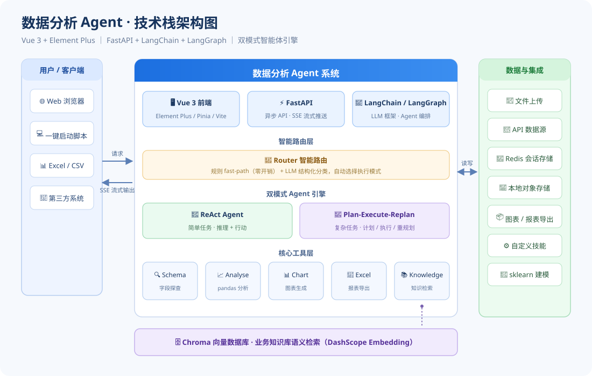
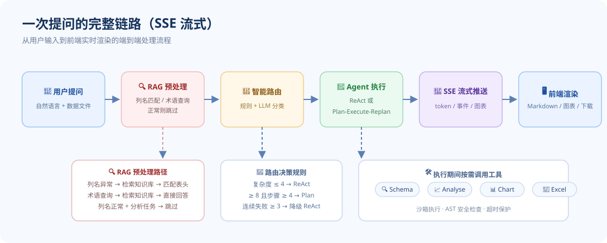
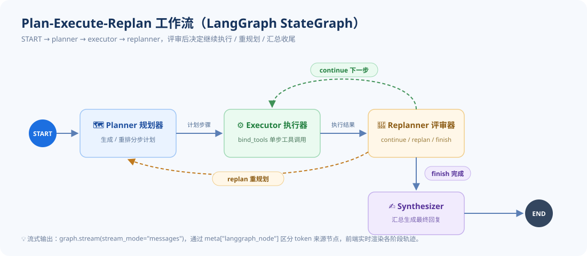

# 📊 数据分析 Agent

> 基于 **Vue 3 + FastAPI + LangChain + LangGraph** 构建的智能数据分析系统。
> 上传 Excel / CSV 或连接 API 数据源，用自然语言提问，Agent 自动完成字段探查、统计分析、图表生成与报表导出，全程流式可见。

<p>
  
  
  
  
  
</p>

---

## ✨ 功能特性

- 🧭 **智能路由**：规则 fast-path + LLM 结构化分类，自动为每个问题选择最合适的执行模式
- 🤖 **双模式 Agent 引擎**
  - **ReAct**：单步推理即时作答，低延迟，默认模式
  - **Plan-Execute-Replan**：复杂任务先规划、分步执行、动态重规划，最后汇总成完整分析报告；连续失败 3 次自动降级 ReAct
- 🔍 **RAG Agent**：对话前自动预处理——无表头 CSV 自动匹配字段名并修复，业务术语查询直接检索知识库回答
- 🛠️ **四大 Agent 工具**：Schema 字段探查 / Analyse 统计分析 / Chart 图表生成 / Excel 报表导出
- 📚 **业务知识库**：DashScope `text-embedding-v4` 向量嵌入 + Chroma 余弦相似度检索，支持字段定义文件和业务术语文档
- 🌊 **SSE 流式输出**：LLM token、工具调用轨迹、路由决策、计划步骤实时推送到前端，过程全透明
- 💾 **多会话管理**：Redis 会话存储（未配置时自动降级本地持久化），历史对话可回溯
- 📦 **一键导出**：分析结果、图表、Excel 报表统一下载
- ⚙️ **自定义技能**：可扩展的技能系统（如数据质量检查），按需挂载
- 🔗 **多数据源接入**：支持 CSV / Excel 文件上传，也可连接 API 数据源

---

## 🏗️ 技术栈架构

<p align="center">
  
</p>

### 三层架构

| 层级 | 技术 | 核心组件 |
| --- | --- | --- |
| **前端** | Vue 3.4 + Pinia + Element Plus + Vite | ChatPanel / AppSidebar / TraceDrawer / KnowledgeDrawer |
| **后端** | FastAPI + uvicorn | REST + SSE 接口层 / 会话管理 / 文件上传 |
| **Agent 核心** | LangChain + LangGraph | ReAct Agent / Plan-Execute-Replan / RAG Agent / Router |

---

## 🔄 核心工作流

### 一次提问的完整链路

从用户输入到前端实时渲染的端到端处理流程：

<p align="center">
  
</p>

### Plan-Execute-Replan 流程

基于 LangGraph StateGraph 实现，四个节点协作：

```
START → planner → executor → replanner ─┬─ continue → executor（下一步）
                                         ├─ replan   → planner（重规划剩余步骤）
                                         └─ finish   → synthesizer → END
```

<p align="center">
  
</p>

---

## 🚀 快速启动

### 方式一：PowerScript 一键启动（推荐）

在项目根目录执行：

```powershell
./start-dev.ps1
```

脚本会自动完成：
1. 检测 Python / Node.js / npm 环境
2. 生成 `.env` 配置文件（从 `.env.example`）
3. 安装缺失的后端 Python 依赖（`pip install -r requirements.txt`）
4. 安装缺失的前端依赖（`npm install`）
5. 单终端同时启动后端（8000）和前端（5173），双日志实时输出
6. 前端就绪后自动打开浏览器

| 服务 | 地址 |
| --- | --- |
| 前端 | http://127.0.0.1:5173 |
| 后端 API | http://127.0.0.1:8000 |
| API 文档 | http://127.0.0.1:8000/docs |

> 💡 LLM API Key 可选——启动后在网页侧边栏「LLM 配置」中填写即可。
> 不想自动开浏览器时：`$env:AUTO_OPEN_BROWSER = "0"` 后再启动。

### 方式二：BAT 一键启动（Windows）

双击项目根目录下的 **`终端命令行一键启动.bat`**，功能与 PowerShell 版一致，适合不熟悉命令行的用户。

### 方式三：手动启动

**后端（Python ≥ 3.10）**

```bash
cd backend
pip install -r requirements.txt
uvicorn main:app --host 0.0.0.0 --port 8000 --reload
```

**前端（Node.js ≥ 18）**

```bash
cd frontend
npm install
npm run dev
```

### 方式四：打包为 EXE

```bash
build_exe.bat
```

打包完成后，产物在 `release\DataAnalysisAgent\` 目录下，双击 `DataAnalysisAgent.exe` 即可运行，无需安装 Python / Node.js。分发时将整个 `release\DataAnalysisAgent\` 文件夹打包为 zip 发送即可。

> ⚠️ 注意：不同启动模式下的数据相互独立

---

## ⚙️ 配置说明

所有配置集中在 `backend/settings.py`，支持环境变量覆盖：

| 配置项 | 环境变量 | 默认值 | 说明 |
| --- | --- | --- | --- |
| LLM 模型 | —（网页端配置） | DashScope 兼容接口 | 模型 / api_base / api_key / temperature 均可在前端运行时修改 |
| Redis | `REDIS_URL` | 空（自动降级本地持久化） | 会话与元数据存储 |
| 对象存储 | `STORAGE_BACKEND` | `local` | 本地文件存储（预留 MinIO） |
| 数据目录 | — | `backend/storage/` | 会话数据 / 图表 / 导出 / 知识库 |
| 知识库嵌入模型 | — | `text-embedding-v4` | DashScope 中文文本嵌入 |
| 知识库 Top-K | — | 3 | 向量检索返回数量 |
| 沙箱超时 | — | 30s | analyse_tool 代码执行超时限制 |
| 会话历史上限 | — | 20 轮 | 超过后自动滚动摘要旧消息 |

---

## 📁 目录结构

```
├── 终端命令行一键启动.bat     # Windows 一键启动
├── start-dev.ps1             # 环境检测 + 依赖安装 + 双服务启动
├── build_exe.bat             # PyInstaller 打包
├── assets/                   # README 架构图（SVG）
├── backend/
│   ├── main.py               # FastAPI 应用入口
│   ├── settings.py           # 全局配置
│   ├── api/                  # REST + SSE 接口层
│   │   ├── chat.py           # 对话（SSE 流式）
│   │   ├── sessions.py       # 会话管理
│   │   ├── upload.py         # 文件上传
│   │   ├── knowledge.py      # 知识库 CRUD + 检索
│   │   ├── skills.py         # 技能管理
│   │   ├── stats.py          # 统计
│   │   ├── code.py           # 代码执行
│   │   ├── config.py         # LLM 运行时配置
│   │   ├── api_source.py     # API 数据源管理
│   │   └── files.py          # 文件下载
│   ├── core/                 # Agent 核心
│   │   ├── router.py         # 智能路由（规则 + LLM 分类）
│   │   ├── agent.py          # ReAct Agent（create_react_agent）
│   │   ├── plan_execute.py   # Plan-Execute-Replan（LangGraph StateGraph）
│   │   ├── rag_agent.py      # RAG Agent（术语查询 + 字段匹配修复）
│   │   ├── tools/            # 4 个 Agent 工具
│   │   │   ├── schema_tool.py    # 字段探查
│   │   │   ├── analyse_tool.py   # 统计分析（Pandas 沙箱）
│   │   │   ├── chart_tool.py     # 图表生成
│   │   │   └── excel_tool.py     # Excel 导出
│   │   └── skills/           # 可扩展技能
│   │       ├── _quality_check_impl.py  # 质量检查实现
│   │       └── quality_check_skill.py  # 质量检查技能
│   ├── services/             # 业务服务层
│   │   ├── agent_service.py      # Agent 编排（路由 → RAG → Agent → 解析）
│   │   ├── knowledge_service.py # 知识检索（普通函数，非 LangChain Tool）
│   │   ├── knowledge_store.py   # 知识库存储（Chroma 向量库）
│   │   ├── session_store.py     # 会话存储（Redis / 本地降级）
│   │   ├── df_registry.py       # DataFrame 注册表
│   │   ├── llm_config.py        # LLM 运行时配置
│   │   ├── storage.py           # 对象存储
│   │   ├── skill_store.py      # 技能存储
│   │   ├── api_source.py        # API 数据源服务
│   │   └── telemetry.py        # 遥测 / trace
│   └── storage/              # 运行时数据
│       ├── charts/           # 生成的图表 PNG
│       ├── exports/          # 导出的 Excel 报表
│       ├── knowledge/        # 知识库（Chroma + knowledge.json）
│       ├── meta/             # 元数据（traces / config）
│       └── sessions/         # 会话数据（按 session_id 分目录）
└── frontend/
    └── src/
        ├── components/       # Vue 组件
        │   ├── ChatPanel.vue         # 聊天主面板
        │   ├── AppSidebar.vue        # 侧边栏（可折叠）
        │   ├── MessageBubble.vue     # 消息气泡
        │   ├── TraceDrawer.vue       # 轨迹抽屉
        │   ├── KnowledgeDrawer.vue   # 知识库抽屉
        │   ├── LLMConfigDialog.vue   # LLM 配置弹窗
        │   ├── CodeRunner.vue        # 代码运行器
        │   ├── SkillDialog.vue       # 技能弹窗
        │   ├── ApiSourceDialog.vue   # API 数据源弹窗
        │   ├── UploadFlow.vue        # 上传流程
        │   ├── NewSessionDialog.vue  # 新建会话弹窗
        │   └── ChatUploadDialog.vue # 对话中上传
        ├── stores/
        │   └── session.ts    # Pinia 状态管理（多会话 / 流式 / 未读提醒）
        ├── api/              # axios + SSE 客户端
        └── utils/            # 格式化 / Markdown 渲染
```

---

## 🔌 主要 API

| 方法 | 路径 | 说明 |
| --- | --- | --- |
| `GET` | `/api/health` | 健康检查 |
| `POST` | `/api/chat` | 发起对话（SSE 流式返回 token / 轨迹 / 图表 / 表格） |
| `POST` | `/api/upload` | 上传 Excel / CSV 数据文件 |
| `GET/POST` | `/api/sessions` | 会话创建与管理 |
| `GET/POST` | `/api/knowledge` | 业务知识库 CRUD 与语义检索 |
| `GET/POST` | `/api/config` | LLM 运行时配置（模型 / API Key / 温度） |
| `GET/POST` | `/api/skills` | 技能管理 |
| `POST` | `/api/code/run` | 代码执行（独立沙箱） |
| `GET` | `/api/stats` | 统计信息 |
| `GET/POST` | `/api/api-source` | API 数据源管理 |
| `GET` | `/api/files/...` | 图表 / 导出文件下载 |

---

## 🧠 技术要点

### 双模式自适应

路由层先走规则 fast-path（零开销），不确定时再调用 LLM 结构化分类。默认走 ReAct，只有 `complexity ≥ 8` 且 `estimated_steps ≥ 4` 才升级到 Plan-Execute-Replan。

### RAG Agent 预处理

对话前自动判断是否需要 RAG 预处理：
- **字段匹配**：列名异常（COL1/COL2、纯数字、编号类）时，检索知识库字段文件，解析出正确表头并执行 `reload_df` 修复
- **术语查询**：用户询问业务术语定义、计算口径时，检索知识库直接回答，不再进入数据分析流程
- **流程控制标记**：`ANSWER_ONLY`（结束对话）/ `CONTINUE_ANALYSIS`（继续分析）/ `RELOAD_COLUMNS`（修复列名）

### 代码沙箱安全		

`analyse_tool` 在受限命名空间中执行 Pandas 代码：
- AST 静态检查拦截 `import` / `eval` / `exec` / 下划线属性 / 无界循环
- 执行前变量预检：扫描未在代码中显式声明的变量引用（如臆造的 `match_map`），在执行前拦截
- 守护线程超时保护（默认 30s）

### Plan-Execute 可靠性

- **Planner 硬约束**：匹配类问题必须先探查 `unique()` 取值再写规则；禁止臆造未定义变量
- **Executor 灵活变通**：基于前序步骤的实际代码和观察结果调整实现，每步独立沙箱
- **失败降级**：连续失败 ≥ 3 次自动降级到 ReAct 模式

### 模型兼容性

Plan-Execute 的 planner / replanner 采用手动 JSON 解析 + Pydantic 校验，兼容不支持 function calling 的模型。

### 流式可观测

`graph.stream(stream_mode="messages")` 拾取所有节点的 token chunk，通过 `meta["langgraph_node"]` 区分来源节点（planner / executor / replanner / synthesizer），前端按阶段渲染轨迹。

### 降级设计

无 Redis 用本地文件持久化；无 API Key 可先进界面再配置；LLM 客户端单例复用连接池。

---

## 🛠️ 技术栈

| 类别 | 技术 |
| --- | --- |
| 前端框架 | Vue 3.4 + TypeScript 5.4 |
| 状态管理 | Pinia 2.1 |
| UI 组件 | Element Plus 2.7 |
| 构建工具 | Vite 5.2 |
| 后端框架 | FastAPI 0.110+ + uvicorn |
| Agent 框架 | LangChain 0.2 + LangGraph 0.1 |
| LLM 接入 | langchain-openai（兼容 DashScope / OpenAI 接口） |
| 向量检索 | ChromaDB 0.5 + DashScope text-embedding-v4 |
| 数据处理 | pandas + numpy + matplotlib + xlsxwriter |
| 会话存储 | Redis 5.0（可降级 fakeredis） |
| 打包 | PyInstaller |
